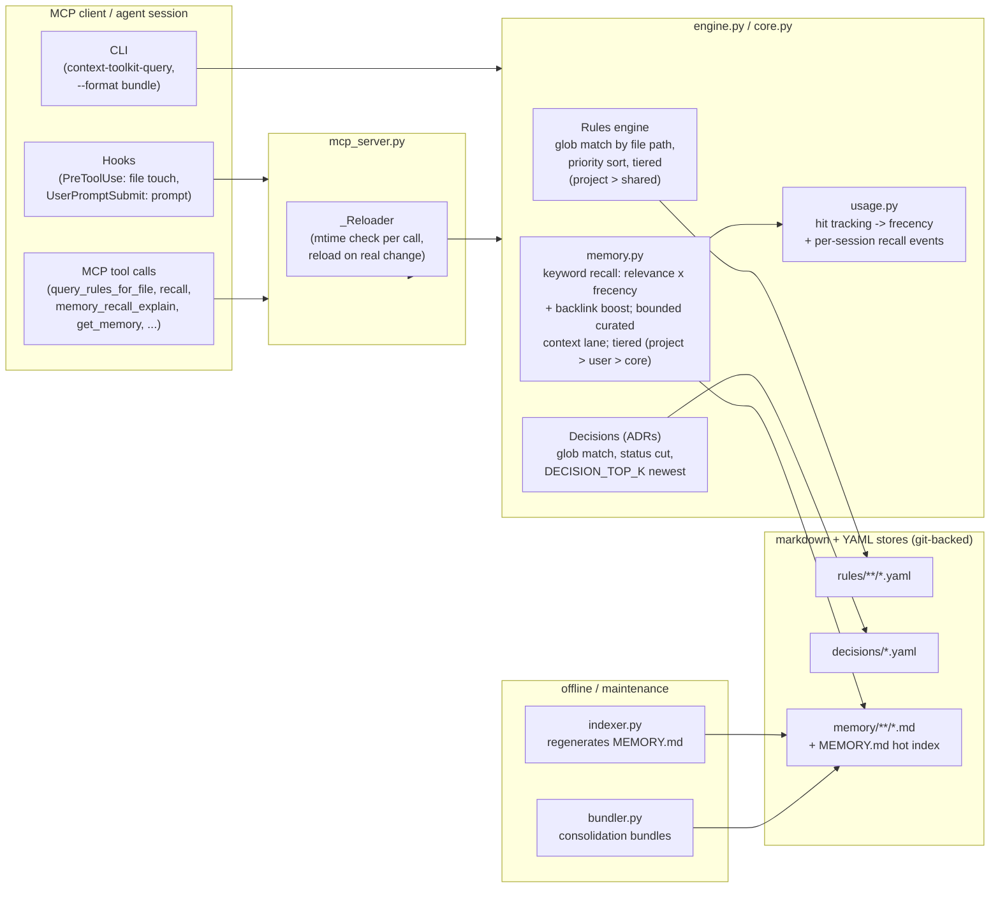

# Architecture

How a query flows from an MCP client (or hook) through the engine to the
markdown stores on disk.

## Design points

- **Stateless per call.** Every query reads from the in-memory model; the
  `_Reloader` re-loads from disk only when the store's max mtime actually
  changed — no file-watcher daemon, safe under concurrent sessions.
- **Tiers, not merges.** Multiple roots (project / shared / user / core) stay
  separate; on a key collision the more specific tier wins. Rules fall back to
  the shared "discipline floor" only when a file matches zero project rules.
- **The store is the API.** Plain markdown/YAML in git — editable by humans,
  agents, and consolidation passes alike. The engine never writes to the store;
  writers are the operator and offline tools (`indexer.py`, `bundler.py`).
- **Frecency, not recency.** `usage.py` records hits per memory; recall ranks
  by keyword relevance weighted with frequency + recency, so long-lived,
  often-used knowledge stays hot without manual pinning. On top, the MCP
  `recall` tool adds a log-dampened **backlink boost** (`log1p(inbound) * 0.1`)
  from the `[[link]]` graph, so structurally central memories rise without
  explicit usage.
- **Curated context is a lane, not a rank weight.** Optional `bausteine`,
  topic, and activity axes remain outside the text index. They can contribute
  at most two candidates only after keyword recall has left result capacity;
  keyword hits therefore retain their order and cannot be displaced. The
  per-session recall event records each delivered candidate's `keyword` and/or
  `context` provenance plus the uncapped context-candidate count, so later
  evaluation can distinguish a context-only recall from a BM25 score.
- **Specific module context wins within that lane.** A caller-supplied Baustein
  is direct evidence, so if it has any curated matches, delivery narrows to
  those module-bound candidates; broad topic/activity candidates remain
  inspectable but do not occupy the same two slots. Path-to-ID mapping and
  graph membership validation are host concerns, not engine behavior.
- **Golden replay tests adapters, not a shadow scorer.** The versioned fixture
  `tests/fixtures/memory_recall_golden.json` carries its own SHA-256 corpus
  fingerprint. `TestGoldenMemoryRecallReplay` rejects corpus drift, establishes
  each case's keyword-only baseline, then runs the real `memory_recall_hits`
  and CLI adapters and requires identical delivered names plus explicit
  include/exclude expectations.
